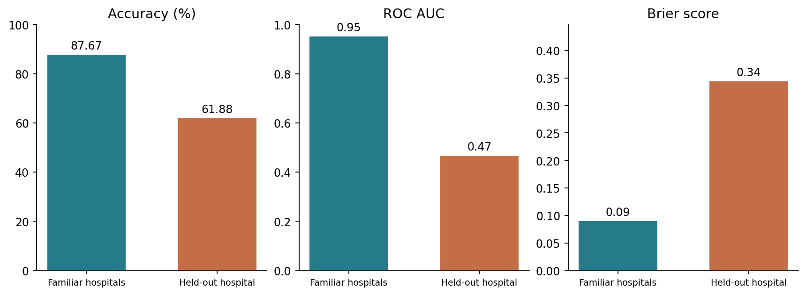
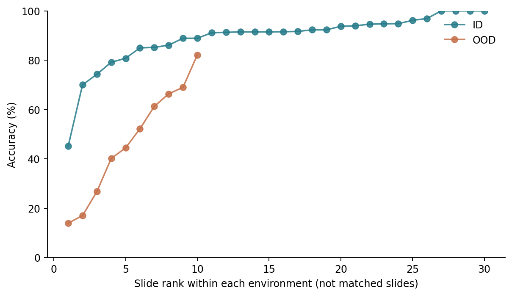

# Research claim

**Replication question:** When the fitted model and prediction task remain fixed, how much does performance change between familiar hospitals and a hospital outside development?

This laboratory examines the claim that strong in-distribution performance can overstate performance in a meaningfully different environment. The prediction task is binary classification of tumor presence in tissue-image patches. Accuracy is the primary outcome so that the direction of the result can be compared with Camelyon17-WILDS [@koh2021]. Balanced accuracy, ROC AUC, and Brier score assess class-specific performance, ranking, and probabilistic prediction quality.

The substantive question concerns whether the evidence travels across environments. It does not require a new model for each test condition. One fitted pipeline is evaluated unchanged on both conditions, using a fixed classification threshold of 0.5.

# Replication strategy

This is a **partial replication**: it retains the Camelyon17-WILDS task and hospital-based split definitions but uses a sampled dataset and a simpler classifier. A pinned public mirror supplies PNG patches and source metadata because the official CodaLab download returned an error. The mirror is not an official Stanford-hosted distribution; its provenance is a limitation, not something assumed away.

The published neural-network baseline is replaced by logistic regression on fixed image statistics so that the analysis can run on a CPU. Therefore, numerical agreement with the original model is not expected, and no claim is made to reproduce its architecture, training procedure, or robustness-algorithm comparisons. The retained comparison is narrower: familiar versus unfamiliar hospitals for the same fitted predictor.

The configuration recorded the sample-selection rule, classifier settings, metrics, threshold, and subgroup analyses before this model's test results were examined. This is a local decision record, not a formal preregistration. No hyperparameter search, threshold search, or model selection used either evaluation set.

# Data and environments

The original benchmark adapts the CAMELYON17 challenge data [@bandi2019]. It uses 96-by-96 tissue patches, with a binary label describing tumor presence in the central 32-by-32 region. Its hospital split provides 302,436 training patches, 33,560 ID validation patches, 34,904 OOD validation patches, and 85,054 OOD test patches. ID validation comes from the same 30 slides as training; the OOD test comes from 10 slides in a different hospital [@koh2021supp].

The implementation follows the official zero-indexed hospital codes: 0, 3, and 4 are development hospitals, 1 is OOD validation, and 2 is OOD testing [@wildscode]. The mirror combines both validation conditions in one directory. Hospital metadata separates the ID observations from OOD validation, which is excluded from this fixed-model experiment.



*Patient and slide identifiers are dataset metadata. Tumor percentages use the recorded sampling weights. “ID” is a held-out evaluation use of the original `id_val` condition; it is not an official ID test split.*

The sample contains **11,200 training patches, 1,500 ID patches, and 3,164 OOD patches**. All three source hospitals and all 30 source slides are represented. The shifted sample contains 9 patients and all 10 target slides. ID and training share 26 patients and 30 slides by design, but no sampled image coordinates or exact image hashes overlap across splits. Target patients and slides are absent from development.

## Sampling and provenance

The PNG mirror is pinned to revision `d784d5344ba6c967f83f9f3d9b2f1e2a4d6eb78f` [@mirror]. Its complete shard counts match the documented training, combined-validation, and test counts. Every processed image was checked for PNG encoding and 96-by-96 dimensions. These checks establish consistency; they do not establish bitwise equivalence to the unavailable official archive.

To limit downloading, entire Parquet row groups were sampled uniformly without replacement within every shard: 8 per training shard, 12 per combined-validation shard, and 8 per test shard. Selection used seed 735 and deterministic file-specific seeds before inspecting labels. Each row group contains at most 100 patches. There are 14 training, 3 combined-validation, and 4 test shards; all were included in the sampling frame.

The realized sample is a cluster sample, not a simple random sample of patches. Its manifest records selected groups, source-row locations, and inclusion probabilities. Weights are inverse inclusion probabilities. Within each evaluation environment these probabilities are constant, so weighting leaves the displayed evaluation averages unchanged. The sample was not adjusted after seeing performance.

# Method and computational record

The pipeline extracts **88 fixed image features** from the whole patch and central 32-by-32 region. For each region, each RGB channel contributes mean, standard deviation, 10th/50th/90th percentiles, and an eight-bin histogram. Grayscale horizontal and vertical gradients and three dark-pixel fractions complete the feature set. Pixels are scaled by the fixed constant 255; no per-image stain normalization is applied.

`StandardScaler` is fitted only on training features. Logistic regression uses `C=1`, the `lbfgs` solver, a maximum of 2,000 iterations, and inverse sampling weights in its fitting objective. It converged after 330 iterations. The fitted scaler, coefficients, and 0.5 decision threshold are reused unchanged for both evaluation sets. Hospital, patient, slide, coordinates, identifiers, and labels are excluded from the predictors.

Accuracy measures the fraction of correctly classified patches. Balanced accuracy averages sensitivity and specificity, helping distinguish a class-mixture effect from class-specific errors. ROC AUC measures ranking over thresholds. Brier score is mean squared probability error; lower is better. It reflects overall probability quality and does not isolate calibration from discrimination.

The accompanying project contains the feature snapshot, source-row manifest, per-image hashes, executable preparation and analysis scripts, exact dependencies, raw predictions, and input/code hashes. Analytical reproduction works offline from the snapshot. Regenerating image features requires access to the pinned mirror.

# Results



*Changes in accuracy and balanced accuracy are percentage points, not relative percentages. AUC and Brier changes are on their original scales.*

{#fig-performance}



The average accuracy decrease is **25.78 percentage points**. The AUC point estimate falls close to chance, while probability error also increases substantially. Comparing the raw magnitudes of these differently scaled metrics would be misleading. The most pronounced interpretable class-level change is the loss of specificity, shown below.

## Class-specific errors and local performance



Tumor sensitivity changes by less than one percentage point, while specificity falls by **52.68 points**. The false-positive rate consequently rises from approximately **8.81% to 61.48%**. The shifted classifier therefore makes many more false tumor classifications among non-tumor patches. An aggregate accuracy number alone would obscure that asymmetry. These are patch-level errors; they cannot be translated directly into patient-level diagnoses or clinical consequences.



{#fig-slides}

The aggregate also hides substantial variation across slides. ID slide sample sizes range down to five patches, whereas every sampled OOD slide has at least 100 patches. Some local estimates are therefore much less stable than others. Minimum, median, and maximum slide accuracies are descriptive summaries, not evidence that a particular slide or patient characteristic caused the difference. Complete slide counts and results are retained in the CSV output.

## Uncertainty



Intervals use 1,000 percentile-bootstrap resamples of patients separately within each environment, with seed 8735. All sampled patches belonging to a resampled patient stay together. This avoids treating neighboring patches as independent observations. The accuracy-difference interval is approximately **−52.37 to −11.36 percentage points**.

Eight OOD bootstrap resamples contain only one class; balanced accuracy is undefined for those resamples. Its OOD and difference intervals therefore use 992 valid replicates, while all accuracy and Brier intervals use 1,000. The exact counts are recorded. These approximate intervals condition on the fitted model and sampled images; they do not represent uncertainty across possible target hospitals or training datasets. With only nine sampled target patients, their precision is limited.

# Diagnosis before intervention

The outcome proportions are nearly equal: approximately 50.8% tumor in ID and 50.6% in OOD. Balanced accuracy also declines substantially, and the class-specific table localizes the problem to non-tumor patches. A different tumor proportion is therefore not an adequate explanation for the observed accuracy loss.



*RGB means are on a 0–1 scale. Standardized differences compare OOD with ID using the training-feature standard deviation.*

The target patches have lower mean red and green intensities in their central regions. The green-channel difference is about 0.78 training standard deviations. Across all 88 features, the largest absolute standardized difference is in the whole-patch fraction of red-channel pixels between 0.125 and 0.25: it increases from 0.66% to 4.18%, or 1.31 training standard deviations. The complete feature audit is retained in `feature_shift.csv`.

These measured differences make color-sensitive representation a plausible vulnerability of this particular classifier. They do not demonstrate that staining caused the errors. Scanner characteristics, tissue composition, sampling, and relationships between features and labels can also contribute.

The provided fields and image dimensions are consistent across environments, and no feature values are missing. Consistent encoding does not prove equivalent acquisition or measurement practices. This design cannot isolate covariate shift from a changed feature-outcome relationship, and a low OOD AUC alone does not identify the causal mechanism. Retraining, recalibration, and changing the threshold are deliberately deferred until after diagnosis.

# Comparison with the anchor paper

@koh2021 report Camelyon17 ERM accuracy of **93.2% ID and 70.3% OOD**, a 22.9-point decrease. The present classifier also deteriorates across hospitals, but its 25.78-point gap is not a numerical replication of that result. A different representation, fitting objective, and sampled cohort can change both performance levels and the gap.

The original baseline uses a DenseNet-121 trained from scratch and aggregates results across 10 seeds [@koh2021supp]. Our experiment uses one deterministic feature-based classifier. Its patient-bootstrap intervals and the paper's between-seed standard deviations quantify different sources of variation and should not be treated as interchangeable.

The benchmark deliberately includes consequential shifts, and this target hospital was selected for visually distinctive patches [@koh2021supp]. The result consequently supports a claim about this defined hospital contrast, not an estimate of how often an arbitrary deployment shift will cause failure.

# Deployment judgment and claim boundaries

**Judgment: Revalidate before deployment in the shifted environment.**

The unchanged classifier's loss of specificity, weakened ranking, and increased probability error make its ID performance an inadequate basis for transport. The evidence does not support autonomous use in the target environment. Because this is a research classifier evaluated on selected patches, it also does not establish that the ID performance would have justified clinical deployment in the source hospitals.

Additional evidence should include an agreed use case and acceptable false-positive/false-negative tradeoff, independent slides and patients from additional hospitals, representative prevalence, patient- or slide-level evaluation, measurement checks, and an external evaluation of any revised pipeline. Threshold changes or recalibration would require separate development data and a subsequent untouched evaluation. No clinical cost or safety threshold was supplied, so no such threshold is invented here.

**Supported claim:** for this fixed sampled-image pipeline, performance is substantially worse at the specified held-out hospital, with degradation concentrated in specificity.

**Unsupported claims:** staining is the proven cause; all unseen hospitals would fail similarly; the published DenseNet result has been numerically reproduced; or these patch-level results establish patient-level performance, fairness across demographic groups, or deployment safety.

# Reproducibility limitations and extension

Several limitations matter to the interpretation. First, the mirror preserves useful metadata and lossless PNG encoding, but no official archive checksum was available for comparison. Pinning its revision and retaining image hashes makes our input reproducible without proving its equivalence to every original patch.

Second, row-group sampling can retain correlated or locally ordered observations and alter the realized mixture of tissue patterns. The known sampling probabilities support weighted summaries, but the patient bootstrap is not a complete design-based variance estimate for the row-group sampling process. A different sampled set could yield a different gap. Small ID slide samples also limit claims about local failures.

Third, ID patches come from the same slides and patients as training. This follows the benchmark's familiar-environment comparison, but it can make ID performance favorable relative to testing new slides even within the same hospitals. The hospital contrast therefore combines changes in institution with a change from familiar slides to entirely new slides and patients.

Fourth, the 88-feature representation is intentionally limited. It can rely strongly on color and simple texture while missing morphology available to a convolutional model. Its failure cannot establish the cause or extent of failure in DenseNet or in clinical pathology systems. Likewise, one target hospital cannot characterize transportability across all institutions. Brier scores on roughly class-balanced research samples should not be interpreted as field calibration under a different prevalence.

**One proposed extension:** conduct leave-one-source-hospital-out evaluation across hospitals 0, 3, and 4. At each of three rotations, fit the same fixed feature pipeline on two hospitals and evaluate the third without tuning its threshold. Prespecify specificity loss as the main diagnostic outcome, with balanced accuracy as a companion measure. This would test whether the observed false-positive problem recurs across other hospital changes or is concentrated in the selected target contrast. It would add evidence about cross-hospital variability without searching for a more favorable model. This extension is proposed, not executed.

# Replication verdict

**Partially Reproduced.** The experiment reproduces the direction of the scoped finding: the same fitted model performs worse in a meaningfully different hospital environment. It does not reproduce the original architecture, full-data analysis, multi-seed results, or robustness-method comparisons, and its numerical gap is not claimed to match the paper.

The replication verdict concerns alignment with the research claim. The deployment judgment concerns whether this classifier has enough relevant evidence for use. They answer different questions.

# Reproduction instructions and transparency

Run `python code/run_analysis.py` from the project directory after installing `requirements.txt`. This regenerates the model, predictions, tables, figures, and session record from `data/features.parquet`. Then run `quarto render replication-lab.qmd --to html`. The HTML embeds its visual assets. To rebuild the image-feature snapshot rather than reuse it, run `python code/prepare_data.py` first; that step requires network access.

The current WILDS repository is used as a documented implementation reference, not presented as a course-specific notebook. The report follows the supplied laboratory workflow and general course replication template. Its simplified classifier is an explicit methodological departure from the paper's baseline. No material from the earlier Bike Sharing draft supplies these results.

AI assistance supported implementation, checking, and drafting. The author remains responsible for reviewing the analysis and defending its decisions. Computational checks do not attest that the report has been independently reviewed by the student or submitted to Canvas.

::: {.callout-note collapse="true" title="Session information and source hashes"}

:::

# References

::: {#refs}
:::
